# Route Following in QgisSweptPath

**Forward and reverse driving, with and without a trailer — how it works and how the code is wired**

> **Scope.** This document describes the route-following feature as implemented in
> `route_follow.py` (header says *VERSION 4, trailer aware*), `simulator.py`, `route_tool.py`
> and the route/undo hooks in `qgis_swept_path.py`. Line numbers (`L123`) refer to those files as uploaded
> in October 2026 and will drift as you edit.
>
> **What was and was not verified.** The controller maths was tested outside QGIS against mock vehicles
> (details in [§1.14](#114-what-has-been-validated)). `vehicle.py` itself was never visible while this was
> written, so every assumption about it is listed in [§1.12](#112-assumptions-and-limits) and
> [§2.2](#22-what-the-code-assumes-about-vehiclepy). None of this was observed running inside QGIS.

---

## Contents

- [0. The one-minute version](#0-the-one-minute-version)
- **[Part 1 — Theory: how route following works](#part-1--theory-how-route-following-works)**
  - [1.1 Vocabulary, symbols and conventions](#11-vocabulary-symbols-and-conventions)
  - [1.2 The vehicle model](#12-the-vehicle-model)
  - [1.3 From mouse clicks to a path](#13-from-mouse-clicks-to-a-path)
  - [1.4 Which point follows the line](#14-which-point-follows-the-line)
  - [1.5 Driving forward](#15-driving-forward-stanley-style-front-axle-tracking)
  - [1.6 Reversing without a trailer](#16-reversing-without-a-trailer-rear-axle-pure-pursuit)
  - [1.7 Reversing with a trailer](#17-reversing-with-a-trailer)
  - [1.8 Speed planning](#18-speed-planning)
  - [1.9 Direction changes (cusps)](#19-direction-changes-cusps)
  - [1.10 Detecting an impossible route](#110-detecting-an-impossible-route)
  - [1.11 The live preview](#111-the-live-preview-and-why-it-matches-the-real-run)
  - [1.12 Assumptions and limits](#112-assumptions-and-limits)
  - [1.13 Tuning guide](#113-tuning-guide)
  - [1.14 What has been validated](#114-what-has-been-validated)
- **[Part 2 — Implementation: how the functions and calls work](#part-2--implementation-how-the-functions-and-calls-work)**
  - [2.1 Files and responsibilities](#21-files-and-responsibilities)
  - [2.2 What the code assumes about vehicle.py](#22-what-the-code-assumes-about-vehiclepy)
  - [2.3 Data structures](#23-data-structures)
  - [2.4 End-to-end call flow](#24-end-to-end-call-flow)
  - [2.5 route_follow.py reference](#25-route_followpy-reference)
  - [2.6 simulator.py reference](#26-simulatorpy-reference)
  - [2.7 route_tool.py reference](#27-route_toolpy-reference)
  - [2.8 qgis_swept_path.py glue](#28-qgis_swept_pathpy-glue)
  - [2.9 Signals and slots](#29-signals-and-slots)
  - [2.10 Worked example, frame by frame](#210-worked-example-with-real-numbers)
  - [2.11 Cookbook: where to change what](#211-cookbook-where-to-change-what)
  - [2.12 Messages and troubleshooting](#212-messages-and-troubleshooting)
- [Appendix A — Equation cheat sheet](#appendix-a--equation-cheat-sheet)
- [Appendix B — Undo snapshot (shares the file, not the feature)](#appendix-b--undo-snapshot)

---

## 0. The one-minute version

"Route following" means: **you draw a line with the mouse, and the vehicle drives it by itself**, going
forward, reversing, or both, with or without a trailer. While you draw, the plugin shows the swept area the
vehicle *will* produce.

1. **Draw.** `RouteTool` collects your clicks. **R** switches between forward and reverse (this starts a new
   *run*). You never click the start; every run begins where the vehicle is.
2. **Preview.** After every mouse move the tool calls `simulate()`, which drives a *virtual* vehicle along
   your clicks with the **same controller the real run uses**, and paints the path, the body outlines, the
   swept area, and (in red) the place where the route becomes impossible.
3. **Finish.** Right-click or Enter emits `routeFinished`. The plugin passes the runs to
   `Simulator.setRoute()`, which builds a `Pilot` (the controller) and starts the normal simulation.
4. **Drive.** Every frame, `Simulator._update_route_control()` asks `Pilot.update()` for a command: *which
   steering angle, which direction, how fast may I go through the upcoming curve, and is everything still
   fine?* The simulator applies it to the real `Vehicle` and calls `vehicle.step()`.
5. **End.** Reaching the end emits `routeEnded(True)`; the plugin stops the run and writes the swept path.
   An impossible route emits `routeFailed(reason)`; the plugin stops, shows the reason and an **Undo run**
   button.

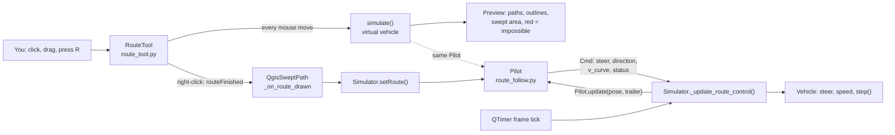

The single most important design fact: **`simulate()` and the real run call the same `Pilot` class.** The
preview is therefore not an approximation drawn by different code, it is the controller itself running
against a simple virtual vehicle.

---

# Part 1 — Theory: how route following works

## 1.1 Vocabulary, symbols and conventions

### Conventions

- Lengths are **map units**. In a metric CRS (your Irish Grid work) that is metres. Speeds are map units
  per second (the dock widget multiplies by 3.6 to show km/h, so the plugin treats them as m/s).
- Angles are **radians**, measured **counter-clockwise from +X (east)**. This is the same as `vehicle.a`.
- **Steering angle is positive to the left.** `steer_left()` increases it, `steer_right()` decreases it.
- `Vehicle.f` is the **front axle centre**. `minivan.py` says so explicitly: *"Base point is point F (front
  axle)"*.

### Symbols

| Symbol | Meaning | Where it lives in code |
|---|---|---|
| F | front axle centre of the tractor | `vehicle.f`, `fx, fy` |
| R | rear axle centre of the tractor | `Geom.rear_from_front()`, `rx, ry` |
| θ (θ₁) | tractor heading | `vehicle.a`, `th` |
| θ₂ | trailer heading | `trailer.a`, `th2` |
| L | wheelbase = distance R → F | `Geom.wheelbase` |
| δ | front wheel steering angle, + = left | `vehicle.steering_angle`, `Cmd.steer` |
| δ_max | steering lock | `Geom.max_steer` |
| H | hitch point | not stored, derived from `c` and `d` |
| c | hitch distance **behind** R, along the tractor axis | `TrailerGeom.c` |
| d | distance hitch H → trailer axle T, along the trailer axis | `TrailerGeom.d` |
| T | trailer axle centre | `art[0], art[1]` |
| β | articulation angle, β = θ₁ − θ₂ | `beta`, `Cmd.beta` |
| β* | wanted articulation angle | `beta_star`, `Cmd.beta_target` |
| s | arc length along the path | `Path.s`, `Loc.s` |
| φ | path tangent direction | `Path.phi`, `Loc.phi` |
| κ | path curvature (1/radius) | `Path.kappa` |
| e | signed cross-track error, **+ = vehicle is left of the path** | `Loc.e` |
| ℓ | chord length from the tracked point to the look-ahead target | local `dist` |
| dt | frame period, 1 / `prop.frames` | `Simulator._time_between_steps` |

### Geometry sketch (tractor + trailer, straight)

```text
 trailer axle T        hitch H        rear axle R                              front axle F
      ●━━━━━━━━━━━━━━━━━━━●━━━━━━━━━━━━━━●━━━━━━━━━━━━━━━━━━━━━━━━━━━━━━━━━━━━━━●━━━━▶  heading θ₁
      |◀──────  d  ──────▶|◀────  c  ───▶|◀──────────────────  L  ──────────────▶|
      (trailer)                          (tractor)
```

`c` can be zero (hitch directly at the rear axle) or negative (hitch in front of the rear axle).

---

## 1.2 The vehicle model

The controller does not know tyres, mass or suspension. It uses the **kinematic bicycle model**: the two
front wheels are replaced by one wheel at F, the two rear wheels by one at R, and wheels never slip sideways.
With the rear axle as reference point and `v` the signed speed (negative = reversing):

$$
\dot x_R = v\cos\theta,\qquad \dot y_R = v\sin\theta,\qquad \dot\theta = \frac{v}{L}\tan\delta
$$

Dividing by `v` gives the form the code actually integrates (`ds` is the distance travelled by the rear axle,
signed):

$$
\frac{d\theta}{ds} = \frac{\tan\delta}{L}
$$

Two consequences matter for everything below:

1. The rear axle follows a circle of radius $R = L/\tan\delta$. Full lock gives the tightest circle.
2. Heading responds to steering **immediately and algebraically** (steer now, heading rate changes now). That
   makes the rear axle the "easy" point to control.

The front axle position is $F = R + L\,(\cos\theta,\ \sin\theta)$.

### Instant steering

In route mode the wheel is **set** to the angle the controller asks for, in the same frame
(`ROUTE_STEER_INSTANT = True`). This is the *stop-start assumption* you asked for: as if the driver may turn
the wheel while standing still. Setting it to `False` turns the wheel at the same rate as manual driving.

### What the real `Vehicle.step()` does

`vehicle.py` was not available. The controller does **not** rely on a specific `step()` model. It is a
feedback controller: each frame it reads the *actual* `f`, `a` (and trailer state) and corrects. In testing,
both a "distance = rear-axle travel" and a "distance = front-axle travel" mock vehicle were tracked equally
well. The preview, however, assumes rear-axle travel (see [§1.11](#111-the-live-preview-and-why-it-matches-the-real-run)).

---

## 1.3 From mouse clicks to a path

### 1.3.1 A route is a list of *runs*

A **run** is one stretch driven in one direction: `{"dir": +1 or -1, "pts": [(x, y), ...]}`. Pressing **R**
while drawing starts a new run in the opposite direction; consequently runs in a tool-drawn route always
alternate forward / reverse, and the vehicle stops at every boundary (a *cusp*, see §1.9).

```text
Route = [ run0: forward  (p1, p2, p3) ,   run1: reverse (p4, p5) ,   run2: forward (p6, p7) ]
```

The clicked points **never include the start**. The start is implicit (next section).

### 1.3.2 Every run starts where the vehicle currently is

When a run becomes active, the path's first point is the **current position of that run's tracked point**
(§1.4), *not* the last point you clicked in the previous run. The vehicle may have stopped slightly short of
or past your last click, so anchoring at the real pose guarantees the new path begins exactly under the
vehicle.

| Run type | First path point |
|---|---|
| forward | front axle F |
| reverse, no trailer | rear axle R |
| reverse, with trailer | trailer axle T |

### 1.3.3 The lead-in

A vehicle cannot move sideways. If your first click were straight to the left of a vehicle that points east,
a path starting with a sideways jump would demand an impossible steering angle at frame one. So the path is
given a short **lead-in**: a straight piece along the *direction of motion* (heading for forward, heading + 180°
for reverse) of length

$$
\text{lead} = \min(\text{LEADIN},\ 0.5\cdot \text{distance to first click}),\qquad \text{LEADIN} = 1.0\ \text{m}
$$

Example from the real code (vehicle at heading 0, first click straight to the left): the path begins
`(2.75, 0) → (3.00, 0.00) → (3.25, 0.00) → (3.40, 0.12) → (3.45, 0.37) …`. It leaves along the heading and
then curves toward the click. If the lead-in would be shorter than 5 cm it is skipped.

### 1.3.4 Corner rounding (Chaikin)

The clicked polyline has sharp corners; a vehicle cannot drive a corner. Each run is therefore rounded with
**Chaikin corner cutting**, `SMOOTHING = 2` iterations. For every segment from $P_i$ to $P_{i+1}$ one
iteration replaces it by two points:

$$
Q_i = \tfrac34 P_i + \tfrac14 P_{i+1},\qquad R_i = \tfrac14 P_i + \tfrac34 P_{i+1}
$$

The first and last point are kept, so the path still starts under the vehicle and ends exactly on your last
click. The result stays inside the convex hull of the clicks and converges to a quadratic B-spline.

**Practical consequence — corners are cut generously.** For a 90° corner with two equal legs of length *a*, the
smoothed path stays about $a/(4\sqrt2)\approx 0.18\,a$ away from the corner you clicked:

| Leg length *a* | 2 m | 5 m | 10 m | 20 m |
|---|---|---|---|---|
| Distance from your corner to the path (measured) | 0.35 m | 0.88 m | 1.77 m | 3.54 m |

If you need the path to pass close to a kerb corner, **add clicks near the corner** (short segments cut very
little) instead of clicking one far-away vertex.

### 1.3.5 Uniform resampling

The rounded polyline is resampled to **one point every 0.25 m** (`SPACING`). A constant point density keeps
curvature estimates and the nearest-point search stable regardless of how fast you clicked or dragged.

### 1.3.6 Path features

The `Path` object precomputes, for every point *i*:

- arc length $s_i$ (cumulative distance),
- tangent direction $\varphi_i = \operatorname{atan2}(\Delta y,\Delta x)$ using the neighbours $i-1$ and $i+1$,
- curvature $\kappa_i = \dfrac{\operatorname{wrap}(\varphi_{i+1}-\varphi_{i-1})}{s_{i+1}-s_{i-1}}$, then
  averaged over a ±3-point window (1.5 m) to remove sampling noise.

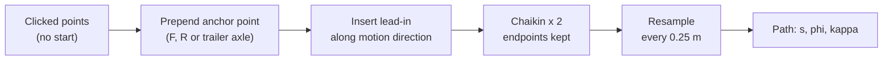

### 1.3.7 Locating the vehicle on the path

Each frame the controller finds *where on the path the tracked point is*:

1. **Coarse search.** Check path points from the previous index forward, at most `SEARCH_WINDOW = 60` points
   (15 m). The window only moves forward. This stops the search from jumping to a later part of a path that
   crosses or doubles back near itself, which is exactly what bay manoeuvres do.
2. **Fine projection.** Project the tracked point onto the two segments around the best index. This yields:
   - $s$, the progress along the path,
   - $\varphi$, the local tangent,
   - $e$, the signed cross-track error: $e=\dfrac{dx\,(y-a_y)-dy\,(x-a_x)}{\lVert(dx,dy)\rVert}$, which is
     **positive when the vehicle is to the left** of the path direction,
   - `dist`, the unsigned distance to the path.
3. **Remaining distance:** `remaining = path.length − s`.

---

## 1.4 Which point follows the line

This is the central design choice. The point that is made to follow your drawn line **changes with direction**:

| Situation | Tracked point | Why |
|---|---|---|
| Forward | **front axle F** | It leads the vehicle; what you see sweeping ahead. |
| Reverse, no trailer | **rear axle R** | In reverse it leads, and it is the easy point (heading → position is first-order). |
| Reverse, with trailer | **trailer axle T** | The last axle leads when reversing; the trailer path is what you care about. |

**Why not just track F when reversing?** The rear axle moves along the vehicle's own axis, so its direction of
travel is set directly by the heading, which steering controls immediately. The front axle in reverse is *dragged*
by the body: to push it sideways you must first swing the body the other way. Such a point is called a
*non-minimum-phase output* in control theory; a controller that insists on holding it on a line while reversing
becomes unstable. Controlling the rear axle, and for a trailer the last axle, avoids that.

That choice also shows in the preview: **orange = front-axle path on forward runs, blue = rear (or trailer)
axle path on reverse runs.**

---

## 1.5 Driving forward: Stanley-style front-axle tracking

Forward runs use a controller in the **Stanley** family. Two corrections are added:

- **Heading error:** $\psi = \operatorname{wrap}(\varphi - \theta)$. Point the wheels along the path.
- **Cross-track correction:** $-\arctan(e / k)$ with $k=1.2$ m (`FWD_SOFTEN`). Steer back toward the path;
  the further away, the harder, saturating smoothly.

$$
\delta = \underbrace{\operatorname{wrap}(\varphi-\theta)}_{\text{heading error}}\;-\;\arctan\!\left(\frac{e}{1.2}\right),
\qquad \delta \leftarrow \operatorname{clip}(\delta,\,-\delta_{max},\,+\delta_{max})
$$

(Classic Stanley has a speed term in the denominator; here the denominator is a constant, so the correction does
not depend on speed.)

**Sign check.** $e>0$ means the vehicle is *left* of the path, so the correction must steer *right*, i.e.
negative; that is why the arctan is subtracted.

| Situation | Result |
|---|---|
| on the line, aligned | δ = 0 |
| 0.3 m left of the line, path heading 5° to the left of the vehicle | 5° − atan(0.3/1.2) = **−9.04°** |
| 1.0 m left, aligned | −39.8° requested, clipped to −25.8° (Caddy lock assumed) |

Why it behaves: the heading term makes the wheels parallel to the path (so a vehicle already on the path stays
on it); the arctan term pulls a displaced vehicle back without overshooting, because the pull weakens as the
heading converges.

---

## 1.6 Reversing without a trailer: rear-axle pure pursuit

Reverse runs track **R** with **pure pursuit**: aim at a point on the path a little ahead of R, and steer so
that R would arc through it.

### Step by step

1. **Look-ahead distance** $L_d=\max(1.2,\ 0.6\,L)$. For the Caddy that is 1.65 m (`REV_LOOKAHEAD_*`).
2. **Target point** $P_t$ = the path point at arc length $s + L_d$ (`Path.point_at`, which extrapolates in a straight
   line beyond the end).
3. **Angle to the target** measured from the *motion* heading. In reverse the motion heading is $\theta+\pi$:
   $$\alpha = \operatorname{wrap}\bigl(\operatorname{atan2}(P_t-R) - (\theta+\pi)\bigr)$$
4. **Arc curvature** through the chord of length $\ell=\lVert P_t-R\rVert$ (classic pure pursuit):
   $$\kappa_{motion} = \frac{2\sin\alpha}{\ell}$$
5. **Steering.** Going forward it would be $\delta=\arctan(L\kappa)$. Reversing flips the relation between steering
   and heading change: $d\theta/d|s| = -\tan\delta/L$, so

   $$\boxed{\ \delta = -\arctan\bigl(L\,\kappa_{motion}\bigr)\ }$$

### Numeric example (Caddy, L = 2.755 m)

Vehicle heading 0 (nose east), R at the origin, reversing west. Look-ahead target at (−3, +0.5):

| Quantity | Value |
|---|---|
| direction to target | 170.5° |
| motion heading | 180° |
| α | −9.46° |
| ℓ | 3.04 m |
| κ_motion | −0.108 1/m |
| **δ** | **+16.6° (steer left)** |

Sanity check by thought experiment: reversing with the wheel turned left rotates the heading clockwise, so the
rear axle drifts toward +y, which is where the target is. ✔

### Why a *short* look-ahead is used

Reversing is slow and the rear axle responds immediately, so a short look-ahead (~0.6 L) gives tight tracking
with no oscillation. Longer look-ahead cuts curves more. Reverse arcs of radius 12 m down to the vehicle's
turning limit were tracked to within about 0.04–0.06 m in testing (§1.14).

---

## 1.7 Reversing with a trailer

Reversing a tractor with a trailer is the one case where the simple "aim at a look-ahead point" idea fails
badly, and it is the reason the old controller jackknifed. This section is the longest because the physics is
the least intuitive.

### 1.7.1 The kinematic model

Add the hitch H, a distance **c behind the tractor rear axle**, and the trailer axle T, a distance **d behind
the hitch** (see the sketch in §1.1). Define the articulation angle $\beta=\theta_1-\theta_2$. The trailer
axle position is

$$
T = R - c\,\mathbf u_1 - d\,\mathbf u_2,\qquad \mathbf u_i=(\cos\theta_i,\ \sin\theta_i)
$$

(`TrailerGeom.axle_from`). With the trailer wheels forbidden to slip sideways, the trailer heading obeys
(derivation: the hitch velocity is $\dot H = v\,\mathbf u_1 - c\,\dot\theta_1\,\mathbf n_1$; the trailer axle
moves only along $\mathbf u_2$, so $\dot\theta_2=\dot H\cdot\mathbf n_2/d$):

$$
\dot\theta_1=\frac{v}{L}\tan\delta,\qquad
\dot\theta_2=\frac{v}{d}\Bigl(\sin\beta-\frac cL\tan\delta\,\cos\beta\Bigr)
$$

Per unit distance travelled by the tractor rear axle ($ds=v\,dt$), the articulation angle changes as

$$
\boxed{\ \frac{d\beta}{ds}=A(\beta)\tan\delta-\frac{\sin\beta}{d},\qquad
A(\beta)=\frac1L\Bigl(1+\frac cd\cos\beta\Bigr)\ }
$$

This is exactly what `simulate()` integrates inside `rates()` (a second-order midpoint step), and the same
equation the inner control loop inverts.

### 1.7.2 Why a trailer jackknifes

Look at the term $-\sin\beta/d$ for a **straight** tractor ($\delta=0$):

| Direction | $d\beta/d\lvert s\rvert$ | Behaviour |
|---|---|---|
| forward | $-\sin\beta/d \approx -\beta/d$ | β **decays**: the trailer lines up behind the tractor. Stable. |
| reverse | $+\sin\beta/d \approx +\beta/d$ | β **grows** as $\beta_0 e^{\lvert s\rvert/d}$. Unstable. |

Reversing in a straight line is an unstable equilibrium: any tiny misalignment is amplified until the trailer
folds against the tractor. The e-folding length is the hitch-to-axle distance *d*. Measured on the real kinematics
with d = 3.6 m, start β₀ = 2°, steering held straight:

| Reversed distance | 3 m | 6 m | 9 m | 12 m |
|---|---|---|---|---|
| β, reversing | 4.6° | 10.5° | 23.9° | 51.9° |
| β, same start driving **forward** 12 m | | | | 0.07° |

The linear prediction $2^\circ\cdot e^{6/3.6}=10.6^\circ$ at 6 m matches the simulation (10.5°).

**The old controller ignored the trailer.** It steered the tractor as if alone; on a simulated pickup + trailer
a straight reverse was fine but every curve jackknifed within about 6–8 m. The fix is not "steer more
carefully", it is to control β actively.

**Why a single look-ahead loop is not enough.** From the steering angle to the trailer axle's sideways position
there are three integrations in a row: δ sets $\dot\beta$, β sets $\dot\theta_2$, θ₂ sets the lateral velocity of T.
A controller that closes one loop around the end of such a chain oscillates or diverges. The solution below is a
cascade: a fast inner loop that tames β, and a slower outer loop that picks the β needed to follow the path.

### 1.7.3 What articulation angle does a given curve need?

In a **steady turn** both headings rotate at the same rate. Geometry then fixes the relation between β and the
curvature $\kappa_2$ of the circle that the trailer axle travels (positive = left, in the trailer's own forward
sense):

$$
\kappa_2=\frac{\sin\beta}{d\cos\beta+c}
$$

Solving for β (this is `beta_from_curvature`):

$$
\beta=\arctan(\kappa_2 d)+\arcsin\!\left(\frac{\kappa_2\,c}{\sqrt{1+(\kappa_2 d)^2}}\right)
$$

For $c=0$ (hitch at the rear axle) this reduces to the textbook $\beta=\arctan(\kappa_2 d)$. The steering
needed to *hold* that β is

$$
\tan\delta_{hold}=\frac{L\sin\beta}{d+c\cos\beta}
$$

and the largest β that the steering can still hold at full lock is $\beta_{sat}$ (`beta_steering_limit`, found
by scanning β in 0.5° steps while $\tan\delta_{hold}\le\tan\delta_{max}$).

Worked numbers for the example pickup + trailer used in testing (L = 3.085 m, c = 1.05 m, d = 3.6 m,
δ_max = 26.5°):

| Trailer-axle radius | β needed | Steering to hold it |
|---|---|---|
| 40 m | 6.6° | 4.4° |
| 20 m | 13.2° | 8.6° |
| 12 m | 21.5° | 13.9° |
| 8 m | 31.1° | 19.5° |

and β_sat = 44.5°. Past β_sat the tractor can no longer keep the angle even with the wheel at full lock, so the
trailer folds regardless of what the controller does.

### 1.7.4 The cascade controller

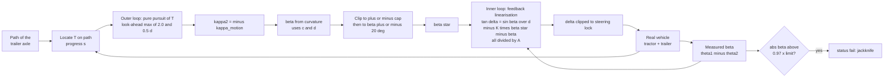

**Outer loop** (slow, path geometry). The same pure-pursuit idea as in §1.6 but applied to the **trailer axle**
and the **trailer's** motion heading $\theta_2+\pi$:

1. Look-ahead $L_d=\max(2.0,\ 0.5\,d)$ (`TRAILER_LOOKAHEAD_*`) → target point on the path.
2. $\alpha=\operatorname{wrap}(\operatorname{atan2}(P_t-T)-(\theta_2+\pi))$ and $\kappa_{motion}=2\sin\alpha/\ell$.
3. In the trailer's own forward sense the same circle is run the other way, so $\kappa_2=-\kappa_{motion}$.
4. $\beta^*=\beta(\kappa_2)$ from §1.7.3, then the safety clipping of §1.7.5.

**Inner loop** (fast, articulation angle). Reversing means $ds=-\lvert ds\rvert$, so
$\dfrac{d\beta}{d\lvert s\rvert}=-A\tan\delta+\dfrac{\sin\beta}{d}$. We *choose* the right-hand side to be a stable
first-order law that pulls β to β\*:

$$
\frac{d\beta}{d\lvert s\rvert}=K\,(\beta^*-\beta),\quad K=1.5\ \text{m}^{-1}
\quad\Longrightarrow\quad
\boxed{\ \tan\delta=\frac{\sin\beta/d-K(\beta^*-\beta)}{A(\beta)}\ }
$$

This is *feedback linearisation*: the first term cancels the unstable "fall-over" term $\sin\beta/d$ exactly, the
second term makes β converge with a length constant $1/K=0.67$ m. Because 0.67 m is much shorter than the outer
look-ahead (≥ 2 m), the loops are well separated in time scale, which is what keeps the cascade stable. The result
is limited to ±δ_max.

**You first steer against the turn, then into it.** Example (c = 1.05, d = 3.6, L = 3.085):

- To *build* β = 20° from β = 0 the inner loop asks $\tan\delta=-1.25$, i.e. −51°, so the wheel goes to **full lock
  the "wrong" way**.
- Once β has reached 20°, *holding* it needs $\delta=+13.0^\circ$ (steer into the turn).

That counter-steer-then-hold pattern is what an experienced driver does when backing a trailer, and it falls
out of the equations; it is not scripted.

### 1.7.5 Safety layers around β\*

The raw $\beta^*$ from the curvature can be larger than is sensible, so it is limited twice:

1. **Cap.** $\text{cap}=0.8\cdot\min(\text{bending limit},\ \beta_{sat})$ (`TRAILER_SAFETY = 0.8`). β\* is clipped to
   ±cap. In the example above the binding one is β_sat = 44.5°, so cap = 35.6°.
2. **Lead limit.** $\beta^*\leftarrow\beta+\operatorname{clip}(\beta^*-\beta,\ \pm20^\circ)$ (`TRAILER_BETA_LEAD`), then
   clipped to the cap again. The reference may not run more than 20° ahead of the real angle, so the steering is
   never asked for more than it can deliver, which prevents overshoot.

Example: the outer loop (target 2.5 m behind and 0.6 m to the side of T) asks for **42.4°** → cap → 35.6° → lead
limit with β = 0 → **20°**.

### 1.7.6 Jackknife detection

If $\lvert\beta\rvert>0.97\cdot\text{limit}$ (`TRAILER_FAIL_FRACTION`) the pilot returns status `fail` with the text
*"The trailer would jackknife (X deg between tractor and trailer, limit Y deg). Use a wider turn or drive forward
first."* Because β\* never exceeds 0.8 of the limit, this normally triggers only when a situation is forced from
outside: a reverse started from an already large angle, or a route tighter than the vehicle can do.

The **bending limit** is read from attributes named `max_bending_angle`, `_max_bending_angle`,
`bending_angle_max`, `max_bend_angle`, `max_hinge_angle`, `_max_hinge_angle`, `max_angle` or `_max_angle` on the
trailer and then on the tractor (values above 3.2 are taken as degrees, capped at 90°). If none exists the default
`TRAILER_MAX_ARTICULATION = 45°` is used.

### 1.7.7 Learning the hitch geometry (c and d)

The controller needs c and d, but the vehicle parts expose *axle points and headings*, not hitch dimensions. They
are measured. The hitch lies on **both** centre lines: the tractor's (through R along θ₁) and the trailer's (through
T along θ₂). Intersecting them:

$$
R+s\,\mathbf u_1=T+t\,\mathbf u_2\ \Rightarrow\ c=-s,\quad d=t,\qquad
\det=\sin(\theta_1-\theta_2)
$$

(`estimate_hitch`; accepted only if $0.3\le d\le25$ and $-4\le c\le8$).

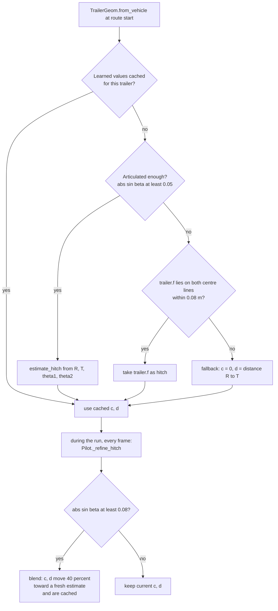

- **Why it can fail to see the hitch when straight.** With β ≈ 0 the two centre lines are almost the same line, so
  their intersection is undefined. A test with β = 0.01 rad correctly returns "unknown".
- **Persistence.** Learned values are stored in a `WeakKeyDictionary` keyed by the trailer object, so they survive
  straight sections and are shared with the preview, which calls `TrailerGeom.sync()` to read them.
- **A deliberately wrong start.** In tests where the trailer's reference point was *not* the hitch, the controller
  began with a wrong guess, still completed the reverse, and converged to the true c and d once β grew past about
  4.6° (sin β ≥ 0.08).
- If the trailer exposes no axle points at all, T is reconstructed from the hitch hint and
  `TRAILER_LENGTH_FALLBACK = 3.5` m.

### 1.7.8 Driving forward with a trailer

Forward runs use exactly the front-axle controller of §1.5; the trailer simply follows. That is stable (§1.7.2:
β decays), but the trailer **cuts corners** (off-tracking), which is why the swept-area preview includes the trailer
body. The route is *not* adjusted to keep the trailer on the line when going forward.

### 1.7.9 Putting numbers on one control step

Pickup + trailer (L = 3.085, c = 1.05, d = 3.6). Trailer axle at the origin, θ₂ = 0, reversing west; target at
(−2.5, +0.6):

| Step | Value |
|---|---|
| motion heading of the trailer | 180° |
| direction to target | 166.5° → α = −13.5° |
| chord ℓ | 2.57 m |
| κ_motion | −0.1815 → κ₂ = +0.1815 (radius 5.5 m) |
| β from curvature | 42.4° |
| after cap (35.6°) and lead limit (β = 0 → 20°) | **β\* = 20°** |
| inner loop, β = 0 | tan δ = −1.25 → δ = −51° → clipped to **−26.5°** |
| inner loop, β = 10°, β\* = 20° | A = 0.417, tan δ = −0.512 → δ = −27.1° (also clipped) |

---

## 1.8 Speed planning

The geometry of a route does not depend on speed (steering is instant and the model is kinematic), so speed only
affects *timing* and *when to slow down*. Each frame the pilot returns `v_curve`, `remaining` and
`stops_at_end`, and the simulator combines them:

$$
\lvert v_{cmd}\rvert=\max\Bigl(v_{floor},\ \min\bigl(v_{cruise},\ v_{curve},\ v_{end}\bigr)\Bigr)
$$

| Term | Definition | Default |
|---|---|---|
| $v_{cruise}$ forward | `prop.route_speed` if it exists, else `ROUTE_CRUISE_SPEED` | 3.0 |
| $v_{cruise}$ reverse | `prop.route_reverse_speed` if it exists, else `ROUTE_REVERSE_SPEED` | 1.5 |
| $v_{cruise}$ reverse with trailer | `min(reverse cruise, ROUTE_REVERSE_SPEED_TRAILER)` | 1.0 |
| $v_{curve}$ | $\sqrt{a_{lat}/\kappa_{max}}$ with $\kappa_{max}$ = largest $\lvert\kappa\rvert$ in the next 5 m (20 points); $a_{lat}$ = `LAT_ACCEL` | 1.5 |
| $v_{end}$ | $\sqrt{2\,a_{brake}\,\max(\text{remaining}-0.3,\,0)}$ if the run ends in a stop (last run or direction change), else = cruise. $a_{brake}$ = `prop.acceleration × BRAKE_FACTOR` | factor 3 |
| $v_{floor}$ | `max(ROUTE_MIN_SPEED, 1.5 × prop.minimum_speed)` | 0.5 |

Since $v^2\kappa\le a_{lat}$ is the same as $v\le\sqrt{a_{lat}R}$, the curve limit depends on the radius like this:

| Curve radius | 20 m | 10 m | 6 m | 4 m |
|---|---|---|---|---|
| $v_{curve}$ | 5.5 m/s | 3.9 m/s | 3.0 m/s | 2.4 m/s |

The floor exists because `Simulator._simulate_frame` only calls `vehicle.step()` when
`abs(speed) > prop.minimum_speed`; without a floor the vehicle could creep to a halt just short of the run
end and stall.

**Speed is signed.** The target is `direction × magnitude`. The vehicle accelerates by
`prop.acceleration × dt` per frame; when the change opposes the current speed (slowing down or reversing
direction) it uses `BRAKE_FACTOR` times that.

**Brake key.** While the brake key is held the magnitude is forced to 0: the vehicle stops but keeps steering;
releasing the key resumes the route. Pausing the simulation also freezes the route.

---

## 1.9 Direction changes (cusps)

At the end of a run the vehicle must stop, select the other gear, and set off the other way. The code calls this
point a **cusp** (the path has a cusp when it reverses direction).

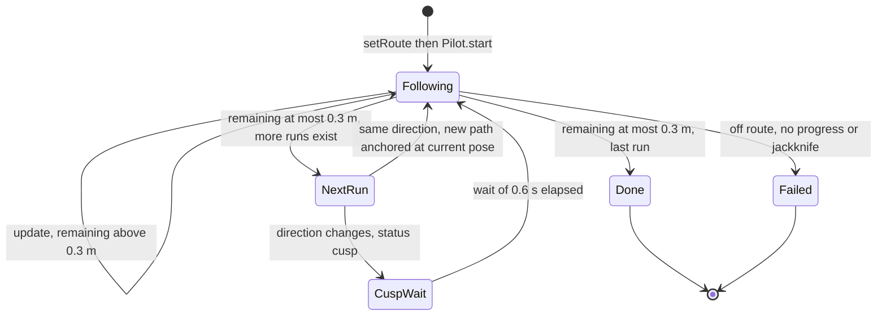

What happens at a cusp, in order:

1. `Pilot.update()` finds `remaining ≤ END_TOL (0.3 m)` and activates the next run. The new path is **anchored at the
   current pose** (§1.3.2). It returns the new run's first command with `status = "cusp"` because the direction
   changed.
2. `Simulator._update_route_control()` sees `cusp`: `_stop_vehicle()` sets the speed to zero immediately and
   `_wait_frames` is set to `ROUTE_CUSP_PAUSE / dt` (0.6 s).
3. During the wait the steering is **already set to the angle the new run needs** (pre-steer), but the speed
   target is zero.
4. After the wait the vehicle accelerates in the new direction.
5. In the **preview** a cusp adds a black "ghost" outline of the vehicle at that spot and does not wait, since
   only geometry is simulated.

Runs drawn in the tool always alternate direction, so every junction is a cusp. A route passed in
programmatically with two runs of the same direction would not stop between them, and because smoothing is done per
run, the junction would stay a sharp corner.

---

## 1.10 Detecting an impossible route

The controller never "knows" in advance that a turn is too tight. It finds out by **failing to follow**: a vehicle
asked for a tighter turn than its steering lock saturates, drifts off the path, and the detectors fire. Three
independent detectors exist:

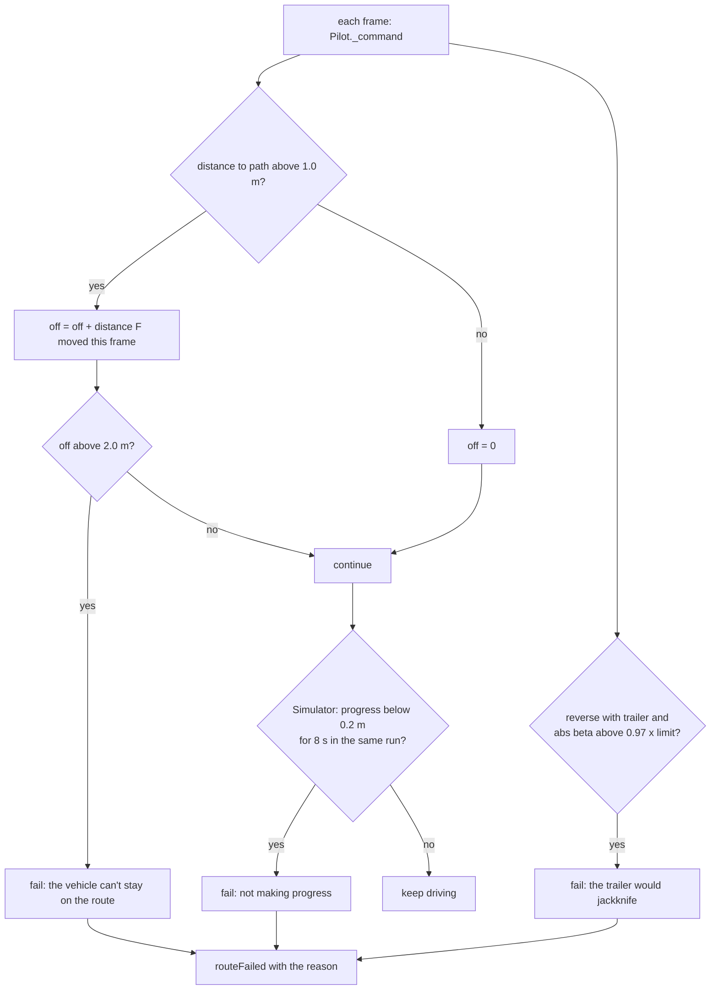

| Detector | Where | Trigger | Default |
|---|---|---|---|
| **Off-route** | `Pilot._command` | tracked point is more than `MAX_DEVIATION` from the path, and the front axle has since travelled more than `FAIL_DISTANCE` | 1.0 m, 2.0 m |
| **Jackknife** | `Pilot._reverse_with_trailer` | articulation above `TRAILER_FAIL_FRACTION` × limit | 0.97 |
| **No progress** | `Simulator._update_route_control` | less than 0.2 m gained along the path for `ROUTE_STALL_TIME`, ignoring cusp waits, the brake key and pause | 8 s |

The off-route detector measures **distance travelled**, not time, so a vehicle that is standing still never
"fails".

**After a failure.** The simulator stops the vehicle, discards the route and emits `routeFailed(reason)`. The plugin
clears the preview, stops the simulation (which commits the undo entry) and shows a red bar message with an
**Undo run** button. In the **preview**, the same detector marks the failing part red and the status bar says
*"Route not possible from the red part: …"*; if you finish such a route anyway, the vehicle drives until it
fails at that same spot.

---

## 1.11 The live preview and why it matches the real run

`simulate(geom, fx, fy, th, runs, step=0.1, tuning=None, th2=None)` runs the **real `Pilot`** against a virtual
vehicle and records what happened.

| Item | In `simulate()` |
|---|---|
| Virtual vehicle | kinematic bicycle; rear-axle distance model; instant steering |
| Trailer | if `geom.trailer` exists, the §1.7.1 equations with a midpoint (RK2) step |
| Step | 0.1 map units of travel per iteration (`RouteTool.PREVIEW_STEP`) |
| Pilot | `Pilot(geom, runs, tuning, refine=False)`: hitch is **not** re-learned here |
| Start state | current front axle pose, plus the *current* trailer heading `th2` read from the vehicle |
| Loop cap | $3\times$ drawn length ÷ step + 2000 iterations |
| Output | `samples`, `ghosts`, `max_beta`, `fail_index`, `fail_reason`, `complete` |

Each `sample` is `(rx, ry, θ, δ, direction, run index, θ₂)`. `ghosts` holds the pose at the start, at every cusp
and at the end.

**What the tool draws from it** (`RouteTool._refresh`):

| Visual | Meaning | Source |
|---|---|---|
| grey dashed line | the points you clicked | `_draw_guide` |
| **orange** line | front-axle path of forward runs | `_draw_paths` |
| **blue** line | rear-axle path of reverse runs; with a trailer the **trailer axle** | `_draw_paths` |
| shaded area, dark edge | swept area; the edge is the outer line of the body (and trailer) | `_draw_envelope` |
| black outlines | vehicle at start, every cusp and the end | `_draw_ghosts` |
| **red** line + red outline | the part the vehicle cannot follow, and where it gave up | `_draw_failure` |
| status bar | direction, and with a trailer the maximum β against the limit; or the failure reason | `_refresh` |

**Swept area.** Body outlines (tractor + trailer) are taken every 0.3 m along the simulated track while the mouse
moves, every 0.12 m after a click, and never more than 450 outlines; they are merged with
`QgsGeometry.unaryUnion`. The union's edge is the envelope you see.

**Why it matches the real run.** Same `Pilot`, same `Geom`/`TrailerGeom`, same `Tuning`. Differences are small and
known: (1) the virtual vehicle is an ideal model while the real `Vehicle.step()` may differ, (2) the preview takes
0.1 m steps, the real run takes one step per frame, and (3) the real run learns the hitch while the preview only
reads what was learned. On mock vehicles the two tracks agreed to **0.10 m**.

---

## 1.12 Assumptions and limits

**Model**

- Kinematic only: no tyre slip, no dynamics, no suspension, no steering-rate limit unless you turn it on.
- Flat 2-D plane; one tractor and **one** trailer (a second trailer follows passively and is not controlled).
- Metric CRS assumed; look-aheads, spacings and speeds are in map units. In a degree-based CRS these numbers are
  meaningless.

**Geometry source**

- Wheelbase, body size and steering lock are read from the vehicle (§2.2); if missing, defaults are used (3.0 m
  wheelbase, 2.0 m width, 0.6 rad lock) and results will be wrong.
- The preview assumes distance = rear-axle travel.

**Control**

- Steering is instant by default (stop-start assumption).
- Route following needs **frame-based** simulation mode. Step-based mode never reads steering input.
- Too-tight turns are detected by *consequence* (§1.10), not by a curvature pre-check.
- The path is rounded (§1.3.4): it cuts corners by up to ~0.18 × the adjacent leg length for a 90° corner.
- When reversing with a trailer, **draw the line behind the trailer axle**, because that is the point that follows
  it. The first click is measured from the trailer axle, not from the tractor.

**Not validated**

- Nothing was observed running inside QGIS; `vehicle.py` and the trailer vehicle files were not available.
- The names the code reads from your vehicles (§2.2) are partly inferred from `minivan.py` and from how
  `qgis_swept_path.py` builds its path points.

---

## 1.13 Tuning guide

### `route_follow.Tuning` (one place for geometry, steering and failure tuning)

| Parameter | Default | Effect | Change it when |
|---|---|---|---|
| `SPACING` | 0.25 m | resampling distance | almost never |
| `SMOOTHING` | 2 | Chaikin iterations; 0 keeps your corners sharp | vehicle fails at your corners (raise or add clicks), or you need less corner cut (lower) |
| `LEADIN` | 1.0 m | straight run-in at each run start | vehicle swings wildly at the very start |
| `FWD_SOFTEN` | 1.2 m | forward cross-track gain, smaller = pulls back harder | forward path wanders (raise) or lags (lower) |
| `REV_LOOKAHEAD_FACTOR` / `_MIN` | 0.6 × L / 1.2 m | reverse (no trailer) look-ahead | reverse swings too late (lower) or oscillates (raise) |
| `END_TOL` | 0.3 m | a run ends this close to its end | vehicle stops short or overshoots run ends |
| `MAX_DEVIATION` | 1.0 m | distance still counted as "on the route" | good routes are rejected (raise) |
| `FAIL_DISTANCE` | 2.0 m | travel off route before failing | same |
| `LAT_ACCEL` | 1.5 | curve speed limit | want faster or gentler curves |
| `CURVE_LOOK` | 5.0 m | how far ahead curvature is checked | late slowing before bends |
| `SEARCH_WINDOW` | 60 points | forward search window | route has very long straight stretches between clicks |
| `TRAILER_MAX_ARTICULATION` | 45° | bending limit if the vehicle does not state one | the plugin's own bending-angle dialog still pops up (lower) |
| `TRAILER_SAFETY` | 0.8 | fraction of the limit ever commanded | want more margin (lower) |
| `TRAILER_FAIL_FRACTION` | 0.97 | jackknife trip point | rarely |
| `TRAILER_INNER_GAIN` K | 1.5 1/m | how fast β follows β\* | snappier (raise) or calmer (lower) |
| `TRAILER_LOOKAHEAD_FACTOR` / `_MIN` | 0.5 × d / 2.0 m | outer-loop look-ahead | trailer wanders (lower) or hunts (raise) |
| `TRAILER_BETA_LEAD` | 20° | max lead of β\* over β | overshoot (lower) |
| `TRAILER_LENGTH_FALLBACK` | 3.5 m | trailer length if axle points unknown | trailer has no axle points |
| `HITCH_BLEND` / `HITCH_MIN_SINBETA` | 0.4 / 0.08 | hitch learning speed and threshold | hitch estimate looks noisy |

### `Simulator` route constants

| Constant | Default | Effect |
|---|---|---|
| `ROUTE_STEER_INSTANT` | `True` | wheel jumps to the angle asked for; `False` = turns at manual-driving speed |
| `ROUTE_STEER_RATE` | 1.0 | steering speed factor when not instant |
| `ROUTE_CRUISE_SPEED` / `ROUTE_REVERSE_SPEED` / `ROUTE_REVERSE_SPEED_TRAILER` | 3.0 / 1.5 / 1.0 | cruise speeds (map units/s) |
| `ROUTE_MIN_SPEED` | 0.5 | speed floor |
| `ROUTE_CUSP_PAUSE` | 0.6 s | standstill at a direction change |
| `ROUTE_MANUAL_OVERRIDE` | `True` | pressing a steer or speed key hands control back to you |
| `ROUTE_STALL_TIME` | 8 s | no-progress timeout |
| `ROUTE_SHOW_TRAILER_INFO` | `True` | message with the detected hitch geometry at route start |

### `RouteTool` constants

| Constant | Default | Effect |
|---|---|---|
| `FREEHAND_MIN_PIXELS` | 8 | freehand point spacing while dragging |
| `DUPLICATE_PIXELS` | 2 | clicks closer than this are ignored |
| `PREVIEW_INTERVAL` | 0.07 s | preview refresh limit while the mouse moves |
| `ENVELOPE_STEP` / `_FINE` | 0.3 / 0.12 m | outline spacing, coarse / after a click |
| `ENVELOPE_MAX_OUTLINES` | 450 | hard cap on outlines to union |
| `PREVIEW_STEP` | 0.1 m | preview simulation step |

---


# Part 2 — Implementation: how the functions and calls work

## 2.1 Files and responsibilities

| File | Role | Needs QGIS? |
|---|---|---|
| `route_follow.py` | **The brain.** Geometry (`Geom`, `TrailerGeom`), path building (`Path`), the controller (`Pilot`), the offline simulator used by the preview (`simulate`), hitch maths, and the undo snapshot helpers. | **No** — pure Python, testable anywhere |
| `simulator.py` | **The driver.** Owns the frame timer; each frame it asks the `Pilot` for a command and applies it to the real `Vehicle`. Also holds manual-driving logic (keys, auto steering). | Yes (`QObject`, `QTimer`) |
| `route_tool.py` | **The drawing tool.** `QgsMapTool` that collects clicks and paints the live preview with rubber bands. | Yes |
| `qgis_swept_path.py` | **The glue.** Creates the tool, wires signals, starts/stops the simulation, writes the path layer, undo. | Yes |
| `vehicle.py`, `vehicles/*.py` | The vehicles themselves (**not visible when this was written**). | Yes |

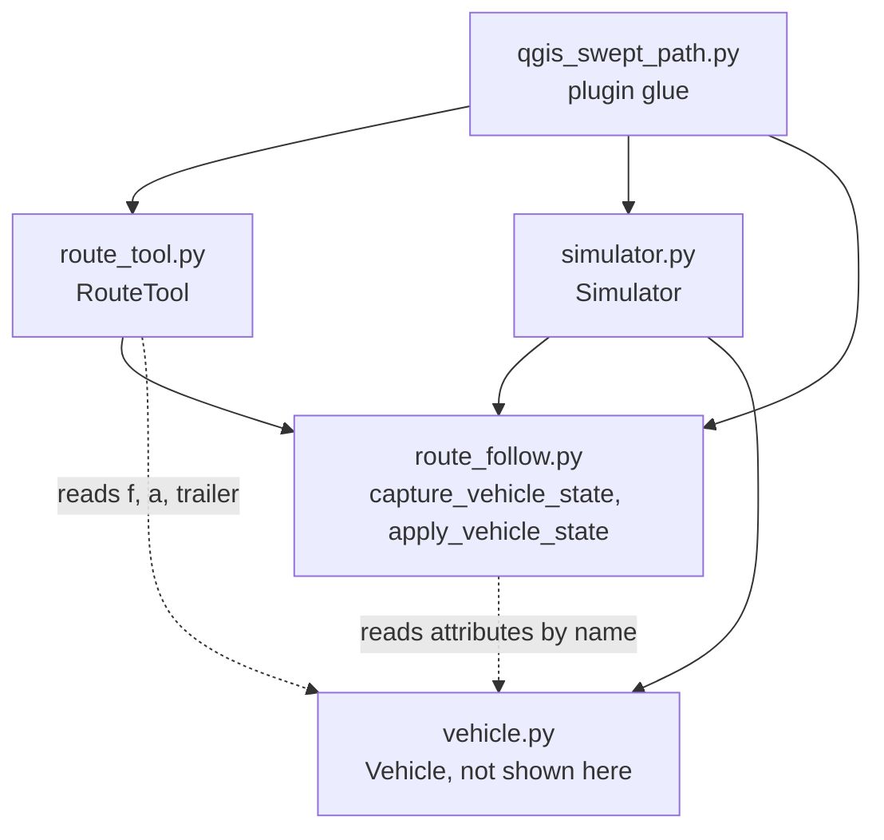

**Rule of thumb:** anything about *what the vehicle should do* lives in `route_follow.py`; anything about *when and
how it is applied to QGIS objects* lives elsewhere. That separation is why the preview and the real run agree.

---

## 2.2 What the code assumes about vehicle.py

The code never imports `Vehicle`. It reads attributes **by name** with forgiving helpers (`_num`, `_pt`,
`_axle_mid`) that return `None` when something is missing. What it looks for:

### Hard requirements (the route cannot run without them)

| Attribute | Used by | If missing |
|---|---|---|
| `vehicle.f.x`, `vehicle.f.y` (front axle) | `Simulator._read_pose`, `RouteTool._refresh` | critical message *"Can't read the vehicle position/heading…"*; preview shows only the grey guide |
| `vehicle.a` (heading, rad, CCW from +X) | same | same |
| `speed`, `steering_angle`, `max_steering_angle` | `Simulator`, `Geom.from_vehicle` | `AttributeError` at run time |
| `speed_up(dv)`, `speed_down(dv)`, `steer_left(d)`, `steer_right(d)`, `step(distance)` | `Simulator` | `AttributeError` |

### Geometry read by `Geom.from_vehicle` (first match wins)

| Quantity | Looked up as | Fallback |
|---|---|---|
| wheelbase L | `front_axle_ref_pos` / `_front_axle_ref_pos` and `rear_axle_ref_pos` / `_rear_axle_ref_pos` → difference | midpoints of `fwl`,`fwr` and `rwl`,`rwr` → then `wheelbase` / `_wheelbase` / `wheel_base` → **3.0 m** |
| body width | `body_width` / `_body_width` | 2.0 m |
| body length | `body_length` / `_body_length` | wheelbase + 1.8 m |
| body ahead of front axle | `front_axle_ref_pos` | 0.9 m |
| steering lock | `max_steering_angle` / `_max_steering_angle` (**radians**; a value above 1.6 is treated as degrees) | 0.6 rad |

Confirmed from `minivan.py`: `_body_length = 4.500`, `_body_width = 1.855`, `_front_axle_ref_pos = 0.890`,
`_rear_axle_ref_pos = 3.645` ("meter from front"), `_turning_circle = 11.40`, `trailer = None`,
`is_main_vehicle = True`, and *"Base point is point F (front axle)"*. For the Caddy that gives L = 3.645 − 0.890 =
**2.755 m**, body ahead of the front axle 0.890 m, body behind the rear axle 4.5 − 0.890 − 2.755 = **0.855 m**. The
examples in this document assume a steering lock of atan(L / 5.7) = 25.8° (half of the 11.40 m turning circle); the
plugin's `Vehicle` computes its own `max_steering_angle`.

### Trailer detection

| What | How |
|---|---|
| trailer part | `vehicle.trailer` if it is not `None` and not callable, otherwise the first entry of `vehicle.vehicle_parts` that is not the vehicle itself and not `is_main_vehicle` |
| trailer heading | `trailer.a` |
| trailer axle T | midpoint of `trailer.rwl`, `trailer.rwr` |
| hitch hint | `trailer.f` (only trusted if it lies on both centre lines) |
| trailer body | corners `trailer.fl`, `fr`, `br`, `bl` (else a default box) |
| tractor rear axle R | midpoint of `vehicle.rwl`, `vehicle.rwr` (else computed from F and L) |
| bending limit | first match in `max_bending_angle`, `_max_bending_angle`, `bending_angle_max`, `max_bend_angle`, `max_hinge_angle`, `_max_hinge_angle`, `max_angle`, `_max_angle` on trailer then tractor, else 45° |

The names `f`, `fl fr bl br`, `fwl fwr`, `rwl rwr`, `vehicle_parts`, `is_main_vehicle`, `has_body`, `has_front_axle`,
`has_rear_axle` are used by `QgisSweptPath.setup_path_points()`, which is how they are known to exist on vehicle
parts. The bending-limit attribute names are a guess; if your trailer files use another name, add it to
`_find_limit`.

---

## 2.3 Data structures

### Runs

```python
runs = [
    {"dir":  1, "pts": [(12.0, 0.0), (20.0, -3.0)]},            # forward
    {"dir": -1, "pts": [(14.0, -3.0), (4.0, -6.0), (-4.0, -6.0)]},  # reverse
]
```

`RouteTool` emits the same thing as `[(list_of_QgsPointXY, direction), ...]`; `Simulator._normalize_runs` converts
it (and also accepts a plain list of points, treated as one forward run).

### `art` — trailer state passed to the pilot

`(trailer_axle_x, trailer_axle_y, trailer_heading, tractor_rear_axle_x, tractor_rear_axle_y)`, or `None` when
there is no readable trailer. Built by `Simulator._read_trailer()` (real run) and by `simulate()` (preview).

### `Loc` — result of locating the vehicle on a path

| Field | Meaning |
|---|---|
| `k` | index of the nearest path point |
| `s` | arc length at the projected point |
| `e` | signed cross-track error, **+ = left of the path** |
| `phi` | path tangent at that point |
| `dist` | unsigned distance to the path |

### `Cmd` — the controller's answer for one frame

| Field | Meaning |
|---|---|
| `status` | `"run"`, `"cusp"` (direction just changed), `"done"`, `"fail"` |
| `reason` | text, only for `fail` |
| `steer` | wanted steering angle, radians, + = left (already clipped to ±δ_max) |
| `direction` | +1 forward, −1 reverse |
| `v_curve` | speed limit from the curvature ahead (∞ if straight) |
| `remaining` | distance left to the end of the current run |
| `stops_at_end` | `True` if the run ends in a standstill (last run or direction change) |
| `deviation` | `Loc.dist` of the tracked point |
| `seg`, `progress` | current run index, arc length reached |
| `with_trailer`, `beta`, `beta_target` | trailer reverse only: flag, measured β, wanted β\* |

### `SimResult` — what the preview gets back from `simulate()`

| Field | Meaning |
|---|---|
| `samples` | list of `(rx, ry, θ, δ, direction, run_index, θ₂)`, one per 0.1 m of travel |
| `ghosts` | list of `(rx, ry, θ, θ₂)` at the start, at every cusp and at the end |
| `max_beta` | largest articulation angle seen (trailer only) |
| `fail_index`, `fail_reason` | index into `samples` where it failed, and why (`None` / `""` if it did not) |
| `complete` | `True` if the pilot reported `done` |

---

## 2.4 End-to-end call flow

### 2.4.1 Drawing, arming, starting

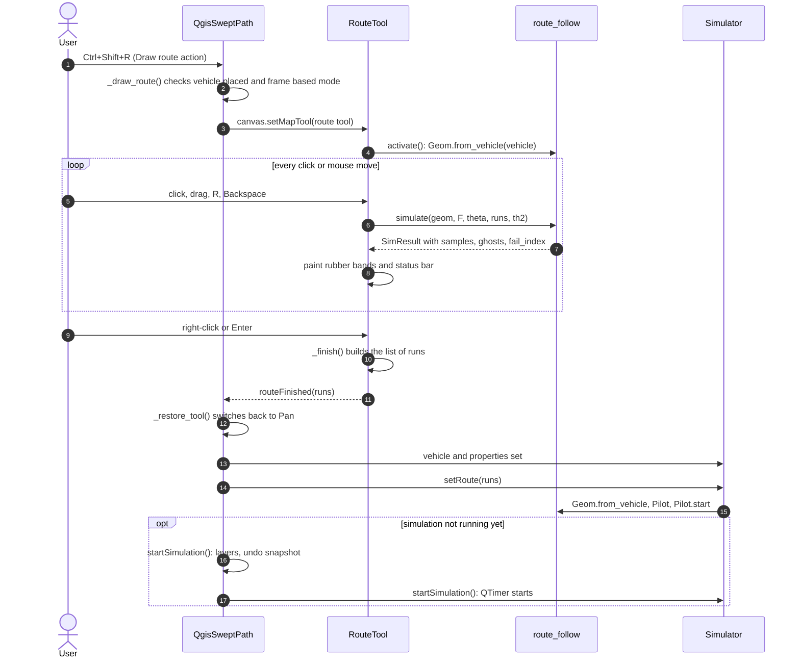

### 2.4.2 One frame, and how a run ends

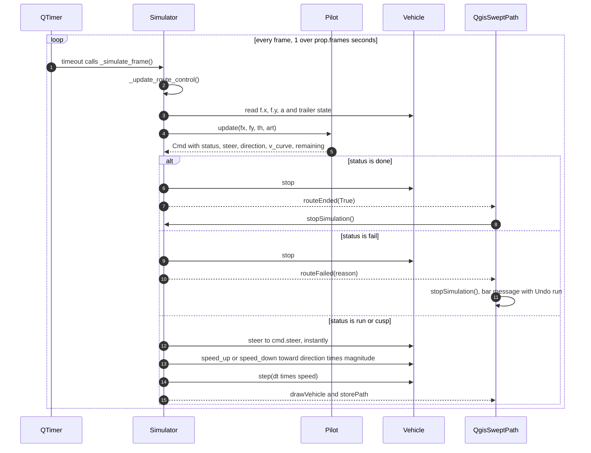

### 2.4.3 Class overview

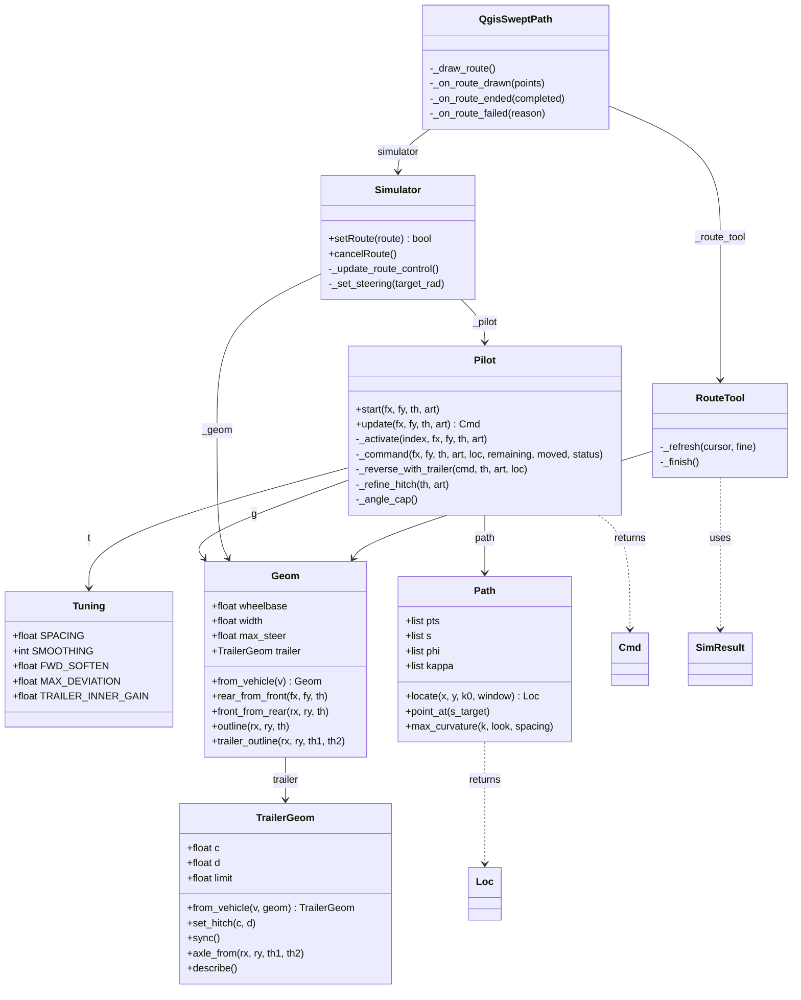

---

## 2.5 route_follow.py reference

### 2.5.1 Module-level helpers

| Function | Line | What it does | Returns |
|---|---|---|---|
| `wrap_pi(a)` | L72 | Wraps an angle into [−π, π). Used for every angle difference. | float |
| `_num(obj, names, default)` | L79 | First attribute in `names` that exists and is numeric (calls it if it is a method). Skips `bool`. | float or `default` |
| `_pt(p)` | L92 | `(x, y)` of a point-like object, whether `x`/`y` are attributes or methods. | tuple or `None` |
| `_axle_mid(part, left, right)` | L103 | Midpoint of two named point attributes (e.g. `"rwl"`, `"rwr"`). | tuple or `None` |
| `find_trailer(v)` | L119 | The trailer part (§2.2). | part or `None` |
| `estimate_hitch(R, th1, T, th2)` | L133 | Intersects the two centre lines. `det = sin(θ₁−θ₂)`; returns `None` if `abs(det) < 0.05` or if `d` is outside 0.3–25 m or `c` outside −4–8 m. | `(c, d)` or `None` |
| `read_articulation(v, geom)` | L154 | Reads current trailer state: `{R, th1, T, th2, H, tr}`. | dict or `None` |
| `_local_outline(tr, T, th2)` | L177 | Trailer body corners expressed in the trailer's own frame (origin T, +x forward). | list or `None` |
| `_find_limit(tr, v, default)` | L186 | Bending-limit lookup (§1.7.6), degrees converted, capped at 90°. | radians |
| `chaikin(pts, iterations)` | L374 | Corner cutting (§1.3.4). Keeps end points. Fewer than 3 points → unchanged. | list |
| `resample(pts, spacing)` | L387 | Uniform arc-length resampling, last point kept. Degenerate (zero length) input → first point twice. | list |
| `beta_from_curvature(k2, c, d)` | L502 | β for a steady turn of curvature κ₂ (§1.7.3). | radians |
| `beta_steering_limit(L, c, d, max_steer)` | L514 | Largest β the steering can hold; scans 0.5° steps up to 90°, stops at the first failure. | radians |

### 2.5.2 `Geom` and `TrailerGeom`

| Method | Line | Behaviour |
|---|---|---|
| `Geom.from_vehicle(v)` | L314 | Reads geometry (§2.2). Converts degrees to radians when lock > 1.6. Then tries `TrailerGeom.from_vehicle` inside `try/except`; any failure just means "no trailer". Called by `Simulator.setRoute` and `RouteTool.activate`. |
| `Geom.rear_from_front(fx, fy, th)` | L349 | R = F − L·(cos θ, sin θ). |
| `Geom.front_from_rear(rx, ry, th)` | L352 | F = R + L·(cos θ, sin θ). |
| `Geom.outline(rx, ry, th)` | L355 | Four body corners (front-left, front-right, rear-right, rear-left) from the **rear-axle** pose, using `front_over`, `rear_over`, `width`. |
| `Geom.trailer_outline(rx, ry, th1, th2)` | L366 | Trailer corners in the world frame: computes T with `axle_from`, then `outline_world`. |
| `TrailerGeom.from_vehicle(v, geom, tuning)` | L210 | Builds c, d (cache → estimate → trailer.f → fallback, §1.7.7), the local outline (or a default box) and the bending limit. |
| `TrailerGeom.set_hitch(c, d)` | L263 | Stores c, d and writes them into the weak cache (key = trailer part). |
| `TrailerGeom.sync()` | L273 | Reads the cache back. Called by `RouteTool._refresh` so the preview uses what the real run learned. |
| `TrailerGeom.axle_from(rx, ry, th1, th2)` | L283 | T = R − c·u₁ − d·u₂. |
| `TrailerGeom.outline_world(tx, ty, th2)` | L288 | Rotates and translates the local outline. |
| `TrailerGeom.describe()` | L292 | The text of the "Trailer detected: …" message. |

### 2.5.3 `Path`

| Method | Line | Behaviour |
|---|---|---|
| `Path(pts)` | L413 | Computes `s`, `phi`, `kappa` (§1.3.6). |
| `locate(x, y, k0, window)` | L443 | Monotone nearest-point search from index `k0` over `window` points, then projection onto the two adjacent segments (§1.3.7). Returns a `Loc`. |
| `point_at(s_target)` | L482 | Path point at arc length `s_target` (first point at or beyond it); beyond the end it extrapolates straight along the last segment. |
| `max_curvature(k, look, spacing)` | L493 | Largest `abs(kappa)` over the next `look / spacing` points. |

### 2.5.4 `Pilot`

State kept between frames: `i` (current run), `path`, `k` (index into the path), `off` (distance travelled while far
off the path), `_last` (previous F), `_tr_run` (is the current run a trailer reverse), `_cap_key` / `_cap` (cached
articulation cap).

| Method | Line | Behaviour |
|---|---|---|
| `Pilot(geom, runs, tuning, refine)` | L558 | Stores inputs. `refine=True` (real run) re-learns the hitch each frame; the preview passes `False`. |
| `start(fx, fy, th, art)` | L572 | Resets `_last` and activates run 0. |
| `_has_trailer(art)` | L577 | `geom.trailer is not None and art is not None`. |
| `_activate(index, fx, fy, th, art)` | L580 | Builds the run's `Path`: chooses the anchor (F, R or T), adds the lead-in, Chaikin, resample. Sets `i`, `_tr_run`, `path`, `k = 0`, `off = 0`. |
| `_tracked_point(fx, fy, th, art)` | L613 | F (forward), T (reverse with trailer) or R (reverse). |
| `_locate(fx, fy, th, art)` | L621 | `path.locate` for the tracked point, updates `k`, returns `(Loc, remaining)`. |
| `_refine_hitch(th, art)` | L627 | If `abs(sin(th − th2)) ≥ HITCH_MIN_SINBETA`, estimates the hitch and blends it in with `HITCH_BLEND`. |
| `_angle_cap()` | L640 | `TRAILER_SAFETY × min(limit, beta_steering_limit(...))`, recomputed only when c or d (rounded to 0.01) change. |
| `update(fx, fy, th, art)` | L651 | **The per-frame entry point**, flow below. |
| `_command(...)` | L678 | Chooses the control law, clips the steering, computes `v_curve`, runs the off-route accounting. |
| `_reverse_with_trailer(cmd, th, art, loc)` | L723 | The cascade of §1.7.4. Fills `cmd.beta`, `cmd.beta_target`, may set `cmd.status = "fail"`, returns δ in radians. |

#### `Pilot.update`

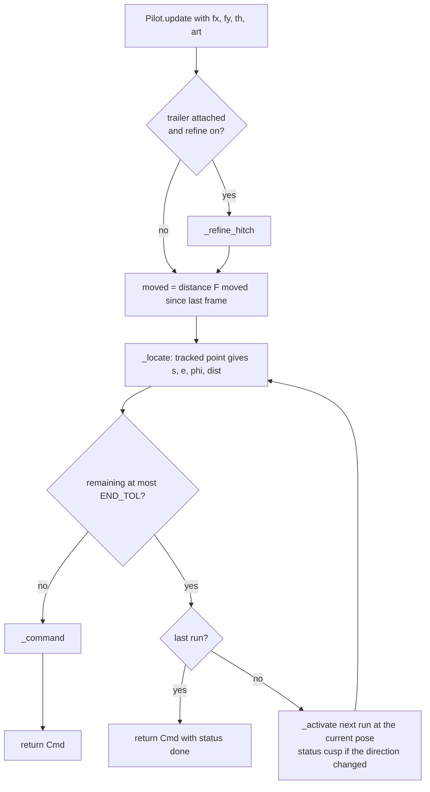

The loop `U8 → U4` is guarded (`guard > len(runs) + 1`), so a run shorter than `END_TOL` is skipped instead of
causing an endless loop.

#### `Pilot._command`

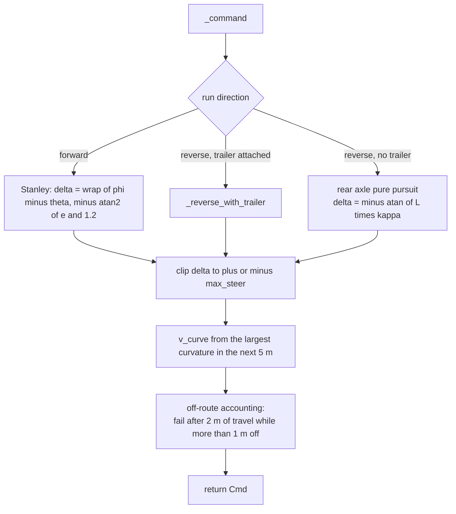

#### `Pilot._reverse_with_trailer`, in code order

1. `beta = wrap_pi(th − th2)`; mark `cmd.with_trailer`.
2. Look-ahead `ld = max(2.0, 0.5·d)` → target on the path → `alpha`, `k_motion`, `k2 = −k_motion`.
3. `beta_star = clip(beta_from_curvature(k2, c, d), ±cap)`.
4. Lead limit: `beta_star = beta + clip(beta_star − beta, ±20°)`, then clip to ±cap.
5. Jackknife test: if `abs(beta) > 0.97·limit` → `cmd.status = "fail"` with the message.
6. Inner loop: `A = (1/L)(1 + (c/d)·cos β)`, `tan δ = (sin β / d − K (β* − β)) / max(A, 1e−6)`, return `atan(tan δ)`.

### 2.5.5 `simulate`

`simulate(geom, fx, fy, th, runs, step=0.1, tuning=None, th2=None)` — L773.

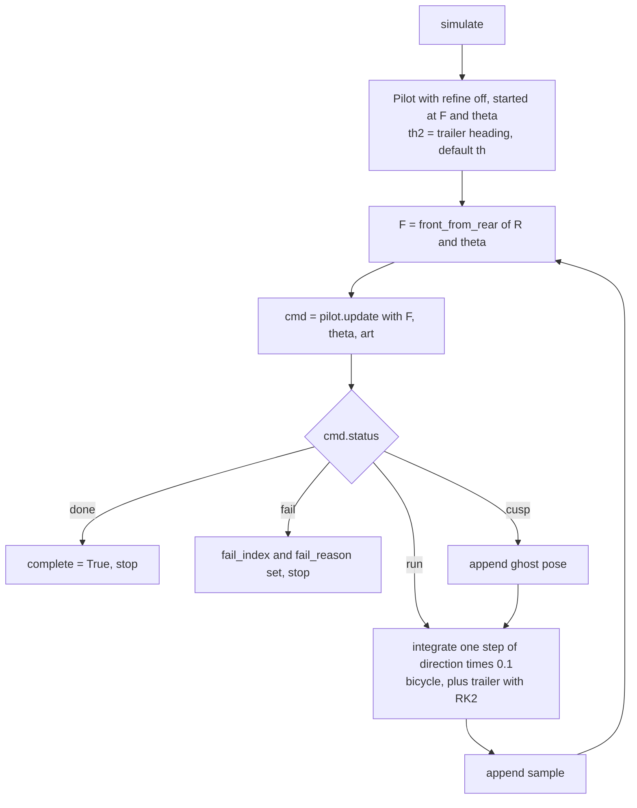

- Runs without points are dropped first. With no runs it returns just the start ghost.
- Without a trailer: `rx += dd·cos(th)`, `ry += dd·sin(th)`, `th += dd·tan(δ)/L`, and `th2 = th`.
- With a trailer: midpoint (RK2) integration of $(\theta_1,\theta_2)$ with `rates(a1, a2)` from §1.7.1; the
  rear-axle position uses the mid-step heading; `max_beta` is updated.
- The final pose is always appended to `ghosts`.

---

## 2.6 simulator.py reference

### Signals

| Signal | Emitted when |
|---|---|
| `drawVehicle` | after every simulated frame; the plugin redraws the vehicle layer |
| `storePath` | every `print_distance` of travel (and at start/stop); the plugin stores path points |
| `routeEnded(bool)` | `True` = route finished; `False` = cancelled |
| `routeFailed(str)` | the route cannot be driven; argument is the reason |

### Route state

`_route_active`, `_pilot`, `_geom`, `_wait_frames` (cusp wait), `_stall_frames`, `_stall_ref` (`(run index,
progress)` at the last time progress was made).

### Methods

| Method | Line | Behaviour |
|---|---|---|
| `route_active` (property) | L238 | `_route_active`. |
| `_normalize_runs(route)` (static) | L242 | Accepts `[(points, dir), ...]` or a plain list of points. Converts `QgsPointXY` (callable `x()`) or tuples to floats, drops consecutive duplicates, maps `dir` to ±1, drops empty runs. |
| `setRoute(route)` | L269 | Normalises; warns and returns `False` if there are no runs or no vehicle; reads the pose; builds `Geom.from_vehicle`, `Pilot(geom, runs, Tuning())`; `pilot.start(F, θ, art)`; resets the wait/stall counters; sets `_route_active`; shows the "Trailer detected" message. Does **not** need the timer (`dt` is only used per frame). |
| `_clear_route()` | L301 | Deactivates and drops the pilot. |
| `cancelRoute()` | L306 | If active: clear and emit `routeEnded(False)`. Called by `stopSimulation()` and by manual override. |
| `_stop_vehicle()` | L313 | Brings the signed speed to exactly 0 using `speed_down` / `speed_up`. |
| `_finish_route()` | L321 | `_stop_vehicle`, clear, emit `routeEnded(True)`. |
| `_fail_route(reason)` | L326 | `_stop_vehicle`, clear, emit `routeFailed(reason)`. |
| `_read_pose()` | L334 | `(f.x, f.y, a)` as floats, or a critical message and `None`. **First place to edit if your vehicle names things differently.** |
| `_read_trailer()` | L350 | The `art` tuple or `None` (also `None` when `_geom.trailer` is `None`). If the trailer axle points are missing it reconstructs T with `axle_from`. |
| `_set_steering(target_rad)` | L369 | Converts radians to vehicle units (`/ steer_unit`), clips to ±`max_steering_angle`, then calls `steer_left` or `steer_right` with the difference. With `ROUTE_STEER_INSTANT = False` the difference is limited per frame to `max_steering_angle / frames_half_steering × ROUTE_STEER_RATE`. |
| `_update_route_control()` | L386 | The per-frame route logic (flow below). |
| `_simulate_frame()` | L527 | The timer callback (flow below). |
| `startSimulation()` / `stopSimulation()` | L169 / L192 | Frame mode computes `_frames_half_steering = steering_time × 0.5 × frames` and `dt = 1 / frames`, then starts the `QTimer`. `stopSimulation` also calls `cancelRoute()` and clears the key flags. |

#### `_update_route_control`

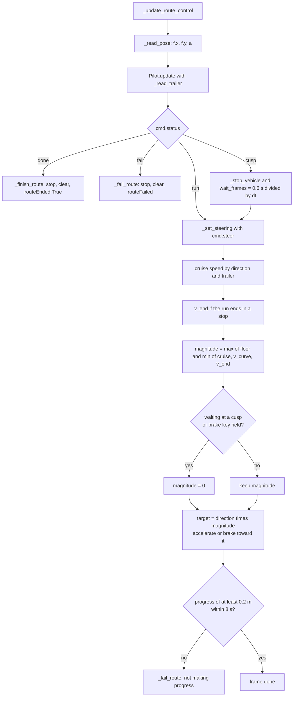

Details worth knowing:

- When the speed *changes sign or shrinks* (`speed × dv < 0`) the step is `accel × dt × BRAKE_FACTOR`; otherwise
  `accel × dt`.
- The stall counter resets while waiting, braking, or paused.
- While **waiting at a cusp** the steering is still set every frame (pre-steer).

#### `_simulate_frame`

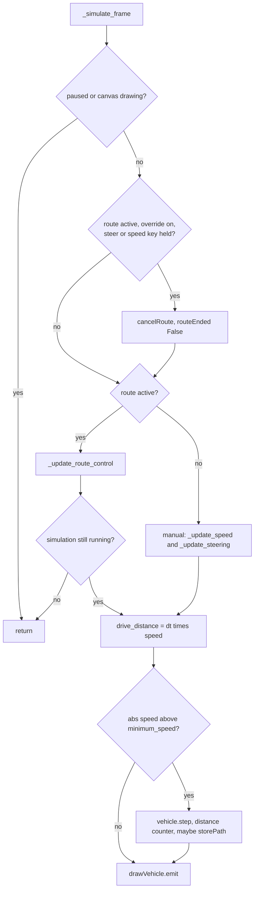

The `simulation still running?` check matters: when a route finishes inside `_update_route_control`, the plugin's
slot `_on_route_ended` stops the whole simulation *during* this call, and the frame must not touch the vehicle
afterwards.

**Manual driving is untouched** by this feature: `_update_speed`, `_update_steering`, `eventFilter`, auto steering
(wheel returns to centre when no key is held, `STEER_HOLD_ON_RELEASE = False`) all work as before; they are simply
skipped while a route is active.

---

## 2.7 route_tool.py reference

`RouteTool(canvas, vehicle_getter)` — L24. `vehicle_getter` is `lambda: self.vehicle` from the plugin; without it
the tool has no preview.

### State

| Field | Meaning |
|---|---|
| `_runs` | `[{"dir": ±1, "pts": [QgsPointXY, ...]}, ...]`; starts as one empty forward run |
| `_geom` | `Geom` built in `activate()` |
| `_finished` | `True` after `_finish()` until the plugin calls `reset()` |
| `_dragging`, `_last_px`, `_last_cursor` | freehand state and last pixel/map position |
| `_last_preview_time` | for the 0.07 s refresh limit |
| `_result` | last `SimResult` |
| seven rubber bands | envelope, guide, forward, reverse, ghost, fail, fail-ghost (each with its own colour) |

### Methods

| Method | Line | Behaviour |
|---|---|---|
| `__init__` | L64 | Creates the rubber bands and the cross-hair cursor. |
| `_make_band(...)` | L95 | One `QgsRubberBand` with stroke, optional fill, width, line style. |
| `activate()` | L109 | `reset()`, builds `Geom.from_vehicle` (so **a vehicle change is picked up on the next activation**), shows the help message, first `_refresh(fine=True)`. |
| `deactivate()` | L123 | Clears the bands **unless the route is finished** (so the preview stays while the vehicle drives). |
| `reset()` / `_clear_bands()` | L129 / L139 | Back to one empty forward run, clear everything. |
| `_vehicle()` | L144 | Calls the getter; returns `None` if the vehicle or `v.f` is missing. |
| `direction` (property) | L156 | Direction of the current (last) run. |
| `_add_part(band, pts, part)` | L163 | Adds a polyline to a rubber band as part `part`. |
| `_refresh(cursor, fine)` | L168 | **The preview pipeline** (below). |
| `_draw_guide`, `_draw_paths`, `_draw_envelope`, `_draw_ghosts`, `_draw_failure` | L220–L337 | One painter per visual (§1.11). |
| `_tracked(rx, ry, th, th2, d)` | L233 | The point that follows the line: F forward; trailer axle or R in reverse. |
| `_bodies(rx, ry, th, th2)` | L262 | Tractor outline plus trailer outline if any. |
| `_add_point(pt, px)` | L339 | Ignores clicks closer than `DUPLICATE_PIXELS` to the previous one. |
| `_toggle_direction()` | L348 | R key logic (table below). |
| `_finish()` | L361 | Builds `[(points, dir), ...]` from non-empty runs; warns if none; sets `_finished`; final fine refresh; warns if part is red; emits `routeFinished`. |
| `canvasPressEvent` / `canvasMoveEvent` / `canvasReleaseEvent` | L383 / L393 / L406 | Left press adds a point and starts dragging; right press finishes; moves add freehand points (at least `FREEHAND_MIN_PIXELS` apart) and refresh at most every `PREVIEW_INTERVAL`; release ends dragging and refreshes fine. |
| `keyPressEvent` | L412 | Esc (reset, `routeCancelled`), R (toggle), Backspace (undo point), Enter (finish). |

**R key logic (`_toggle_direction`):**

| State of the last run | Result of pressing R |
|---|---|
| has points | a new empty run in the **opposite** direction is appended |
| empty, and it is not the only run | that empty run is removed (you are back in the previous direction) |
| empty, and the only run | the **starting** direction flips |

**Backspace:** removes the last point of the last run; if that run is already empty and there is more than one run,
the empty run is removed (which also removes a direction switch).

### `_refresh` pipeline

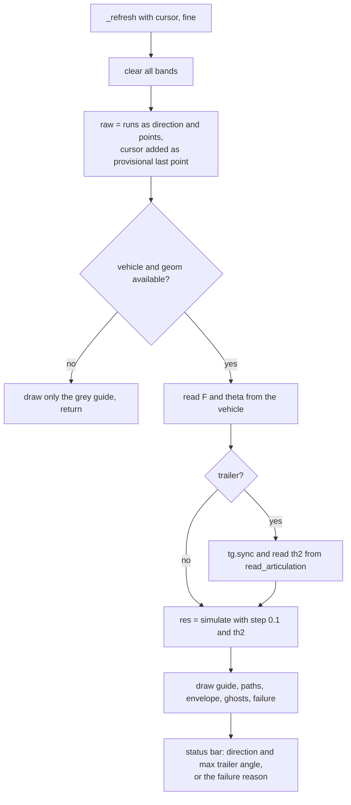

### Tool states

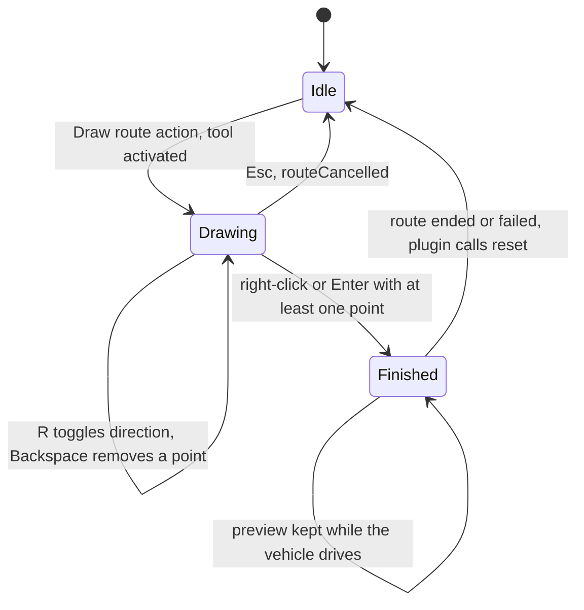

---

## 2.8 qgis_swept_path.py glue

| Code | Line | Role in route following |
|---|---|---|
| `RouteTool(self.canvas, lambda: self.vehicle)` and the two `connect` calls | L96–L98 | Creates the tool **once in `__init__`**, with a getter so it always sees the current vehicle; connects `routeFinished` and `routeCancelled`. |
| `self.simulator.routeEnded.connect(...)`, `routeFailed.connect(...)` | L149–L150 | Done in `run()` because the `Simulator` is created there (and destroyed in `onClosePlugin`). |
| `setupControls()` → `add_action("Draw route", self._draw_route, ..., shortcut="Ctrl+Shift+R")` | L218 ff. | The menu/toolbar action. |
| `_draw_route()` | L170 | Guards: simulator exists, vehicle placed (`is_placed`), `FRAME_BASED` mode; then `canvas.setMapTool(self._route_tool)`. |
| `_restore_tool()` | L185 | `iface.actionPan().trigger()` (the same approach used after placing a vehicle). |
| `_on_route_drawn(points)` | L189 | Restores Pan; sets `simulator.vehicle` and `properties`; `simulator.setRoute(points)`; if the simulation is not running calls the plugin's own `startSimulation()` (layers, buttons, undo snapshot, key filter) and, if that failed, `cancelRoute()`; focuses the canvas so key presses reach the simulator. |
| `_on_route_cancelled()` | L210 | Restores Pan. |
| `_on_route_ended(completed)` | L213 | Resets the tool (clears the preview). If `completed` and still running → plugin `stopSimulation()` (writes the swept path, commits the undo entry). |
| `_on_route_failed(reason)` | L899 | Resets the tool; stops the simulation if running; shows a bar message *"Route not possible"* with an **Undo run** button. |
| `_undo_from_message(item)` | L913 | Runs `undo_last_run()` and removes the bar message. |
| `startSimulation()` → `_begin_undo_entry()` | L580 / L827 | Snapshot of the vehicle **before** the run. |
| `stopSimulation()` → `_commit_undo_entry(...)` | L554 / L837 | Stores the written path feature ids with the snapshot. |

**Order matters in `_on_route_drawn`:** `setRoute()` is called *before* `startSimulation()`. That is fine because
`setRoute()` only needs the vehicle pose and geometry; the frame period is first needed on the first tick.

**Ownership:** the tool lives as long as the plugin object; the `Simulator`, dock widget and properties live only
while the dock is open. That is why the tool is created in `__init__` and the simulator signals in `run()`.

---

## 2.9 Signals and slots

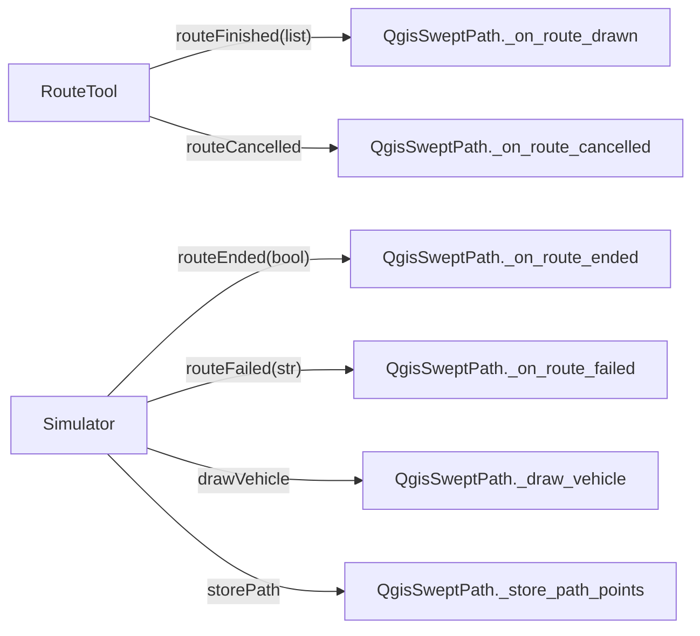

`storePath` is connected only when `prop.print_path` is on (in `startSimulation`), and disconnected in
`stopSimulation`.

**Possible re-entrancy:** `Simulator.stopSimulation()` calls `cancelRoute()`, which emits `routeEnded(False)`, which
calls the plugin's `_on_route_ended(False)` (reset the tool only). When a route *finishes*, `_finish_route()` has
already cleared the route before emitting `routeEnded(True)`, so the later `cancelRoute()` is a no-op and nothing
loops.

---

## 2.10 Worked example with real numbers

**Setup.** Caddy (L = 2.755 m, width 1.855 m, length 4.5 m, assumed lock 25.8°). Rear axle at (0, 0), nose east,
so F = (2.755, 0). The user draws a forward run to (12, 0) and (20, −3), presses **R**, then reverses via
(14, −3), (4, −6) and (−4, −6).

```python
runs = [{"dir":  1, "pts": [(12, 0), (20, -3)]},
        {"dir": -1, "pts": [(14, -3), (4, -6), (-4, -6)]}]
```

**Run 0 (forward)**

- `Pilot._activate(0, …)`: anchor F = (2.755, 0), lead-in 1 m east, Chaikin ×2, resample → **72 points, 17.70 m**.
- First frame: `steer = 0°`, `remaining = 17.70`, `stops_at_end = True` (the next run reverses), `v_curve = ∞`.
- The vehicle then follows the line at 3.0 m/s, slowing for the end via `v_end`.

| Travel | Run | R (x, y) | F (x, y) | θ | δ |
|---|---|---|---|---|---|
| 0.0 m | 0 fwd | (0.10, 0.00) | (2.85, 0.00) | 0.0° | 0.0° |
| 6.0 m | 0 fwd | (6.10, 0.00) | (8.85, 0.00) | 0.0° | 0.0° |
| 9.0 m | 0 fwd | (9.10, −0.11) | (11.84, −0.35) | −4.9° | −5.9° |
| 15.0 m | 0 fwd | (14.97, −1.28) | (17.60, −2.10) | −17.4° | −3.3° |

**Cusp** at 17.4 m of travel. The last forward frame has `remaining ≤ 0.3 m`, so the pilot activates run 1 anchored
at the **rear axle**, R = (17.15, −2.00) (heading −19.2°). The path starts with a lead-in *backwards along the
heading* (toward up-left), then curves to your first reverse click. The simulator stops the vehicle, waits
0.6 s, and the steering is already at the new run's angle.

**Run 1 (reverse)** — path of **89 points, 21.84 m**.

| Travel | Run | R (x, y) | F (x, y) | θ | δ |
|---|---|---|---|---|---|
| 18.0 m | 1 rev | (16.48, −1.81) | (19.17, −2.39) | −12.2° | **−25.8°** |
| 21.0 m | 1 rev | (13.52, −1.93) | (16.14, −1.08) | 18.0° | **−25.8°** |
| 24.0 m | 1 rev | (10.96, −3.46) | (13.19, −1.84) | 35.9° | +15.5° |
| 30.0 m | 1 rev | (5.35, −5.44) | (8.06, −4.94) | 10.6° | +3.2° |
| 36.0 m | 1 rev | (−0.61, −6.02) | (2.14, −6.01) | 0.1° | +1.9° |
| 39.1 m | 1 rev | (−3.71, −6.00) | (−0.96, −6.01) | −0.2° | −0.4° |

**Reading the table.**

- The **end** is accepted when R is within 0.3 m of your last click (−4, −6): R ends at (−3.71, −6.00). ✔
- Steering is **−25.8° (full lock) for 5.3 m** at the start of the reverse. The rear axle must swing around
  because the first reverse click (14, −3) is only about 3 m from where the vehicle stopped, so the path's own
  curvature there is R ≈ 1.9 m, tighter than the vehicle's 5.7 m turning radius allows. Pure pursuit recovers, the
  largest distance from the path is **1.04 m** (just over `MAX_DEVIATION = 1.0 m` but not for 2 m of travel, so no
  failure).
- **Tip from this example.** Put the first click of a reverse run further out. With the first click at (10, −3.5)
  instead, the run has 4.3 m at full lock and a maximum deviation of 0.51 m.

**Trailer variant (one control step).** See the table at the end of §1.7.9: it follows one pure-pursuit and one
inner-loop evaluation with real numbers.

---

## 2.11 Cookbook: where to change what

> **After editing any of these files, restart QGIS.** The Plugin Reloader only reloads the plugin's main module,
> not `route_follow.py`, `simulator.py` or `route_tool.py` (a stale `vehicle_state.py` caused exactly this earlier).

| I want to… | Change | Where |
|---|---|---|
| …the wheel to turn at a limited rate in route mode | `ROUTE_STEER_INSTANT = False` (and `ROUTE_STEER_RATE`) | `simulator.py` |
| …faster/slower driving | `ROUTE_CRUISE_SPEED`, `ROUTE_REVERSE_SPEED`, `ROUTE_REVERSE_SPEED_TRAILER`, or add `route_speed` / `route_reverse_speed` to the properties object | `simulator.py` / properties |
| …the forward path to hug the line harder | lower `FWD_SOFTEN` (try 0.8; too low oscillates) | `Tuning` |
| …reverse (no trailer) to steer earlier or smoother | `REV_LOOKAHEAD_FACTOR` / `REV_LOOKAHEAD_MIN` | `Tuning` |
| …the trailer to track tighter | lower `TRAILER_LOOKAHEAD_FACTOR`; raise `TRAILER_INNER_GAIN` | `Tuning` |
| …more safety margin before jackknife | lower `TRAILER_SAFETY` or `TRAILER_MAX_ARTICULATION` | `Tuning` |
| …the path to cut corners less | `SMOOTHING = 1`, or click more points near corners | `Tuning` / drawing |
| …fewer false "route not possible" | raise `MAX_DEVIATION` and/or `FAIL_DISTANCE` | `Tuning` |
| …a longer pause at direction changes | `ROUTE_CUSP_PAUSE` | `simulator.py` |
| …different vehicle attribute names | `Simulator._read_pose`, `Geom.from_vehicle`, `read_articulation`, `_find_limit` | `simulator.py`, `route_follow.py` |
| …a lighter or finer swept-area preview | `ENVELOPE_STEP`, `ENVELOPE_STEP_FINE`, `ENVELOPE_MAX_OUTLINES`, `PREVIEW_INTERVAL` | `route_tool.py` |
| …different preview colours | the `QColor(...)` values in `RouteTool.__init__` | `route_tool.py` |
| …a different key for direction switch | `Qt.Key.Key_R` in `keyPressEvent` | `route_tool.py` |
| …a new failure rule | add it in `Pilot._command` (set `cmd.status = "fail"` and `cmd.reason`); both preview and real run pick it up | `route_follow.py` |
| …route following in step-based mode | not supported: that mode never reads steering input; it would need a separate loop | `simulator.py` |

---

## 2.12 Messages and troubleshooting

### Messages you may see

| Message | Source | Meaning |
|---|---|---|
| *Draw route: The vehicle must first be created and placed.* | `_draw_route` | create and place a vehicle first |
| *Draw route: Route following needs the frame based simulation mode.* | `_draw_route` | set simulation mode to frame based in the properties |
| *Draw route: Click at least one point.* | `RouteTool._finish` | finished with nothing drawn |
| *Draw route: Part of this route can't be driven (shown in red)…* | `RouteTool._finish` | the preview marked a failure; the vehicle will stop there |
| *Route: A route needs at least one point* | `Simulator.setRoute` | empty route or no vehicle |
| *Route following: Can't read the vehicle position/heading (expected vehicle.f.x, vehicle.f.y, vehicle.a).* | `Simulator._read_pose` | your vehicle does not expose these names |
| *Route: Trailer detected: hitch X m behind the rear axle, trailer axle Y m behind the hitch, bending limit Z deg* | `Simulator.setRoute` | the geometry the controller will use; **check these numbers** |
| *Route not possible: The vehicle can't stay on the route (it is X m off the line)…* | `Pilot._command` | off-route detector; "trailer" instead of "vehicle" when reversing with a trailer |
| *Route not possible: The trailer would jackknife (…)* | `_reverse_with_trailer` | articulation reached 0.97 × the limit |
| *Route not possible: The vehicle is not making progress along the route.* | `Simulator` stall check | no progress for 8 s |
| status bar: *Route direction: FORWARD/REVERSE, then \| max trailer angle … (limit …)* | `RouteTool._refresh` | normal preview information |
| status bar: *Route not possible from the red part: …* | `RouteTool._refresh` | the preview's failure reason |

### Symptoms, causes, fixes

| Symptom | Likely cause | What to do |
|---|---|---|
| No preview, only a grey dashed line | tool has no vehicle (`vehicle_getter` returned `None`), or `v.f` missing, or the tool was activated before a vehicle existed (`_geom` is built in `activate()`) | create and place the vehicle, then press **Draw route** again |
| Preview looks right, real run differs | the real `Vehicle.step()` moves differently from the ideal model; or vehicle attribute names differ | compare the "Trailer detected" numbers; inspect `_read_pose`; share `vehicle.py` |
| Vehicle steers *away* from the line | steering sign or heading unit differs from the assumptions (§1.1) | check that `steer_left` increases `steering_angle` and that `a` is radians CCW from +X |
| Forward path wanders | `FWD_SOFTEN` too low for your frame rate | raise it |
| Reverse still swings late | reverse look-ahead too long | lower `REV_LOOKAHEAD_FACTOR` |
| Trailer still wanders | outer look-ahead too long or inner gain too low | lower `TRAILER_LOOKAHEAD_FACTOR`, raise `TRAILER_INNER_GAIN` |
| "Trailer detected" shows odd numbers | the trailer part's axle/heading attributes are named differently | adapt `read_articulation` / `_find_limit` |
| Plugin's own "Maximal bending angle reached" dialog still appears | the vehicle's real limit is smaller than the one the controller uses | lower `TRAILER_MAX_ARTICULATION`, or expose the limit under one of the known names |
| Route "not possible" on a route that looks fine | corner rounding cut your corner, or the reverse run's first click is too close | add clicks near corners; move the first reverse click further out |
| Vehicle creeps or stops short | speed floor vs `prop.minimum_speed` | check `ROUTE_MIN_SPEED` and `prop.minimum_speed` |
| Edits have no effect | QGIS still holds the old module | restart QGIS |

---

## Appendix A — Equation cheat sheet

**Bicycle model** (rear-axle reference, $v$ signed):

$$\dot x_R=v\cos\theta,\quad \dot y_R=v\sin\theta,\quad \dot\theta=\frac vL\tan\delta,\quad F=R+L(\cos\theta,\sin\theta)$$

**Chaikin:** $Q=\tfrac34P_i+\tfrac14P_{i+1},\ R=\tfrac14P_i+\tfrac34P_{i+1}$. Corner cut for a 90° corner with equal
legs *a*: $a/(4\sqrt2)$.

**Forward (Stanley-style):** $\delta=\operatorname{wrap}(\varphi-\theta)-\arctan(e/1.2)$.

**Reverse, no trailer (pure pursuit on R):**
$\alpha=\operatorname{wrap}(\operatorname{atan2}(P_t-R)-(\theta+\pi))$,
$\kappa=\dfrac{2\sin\alpha}{\ell}$, $\delta=-\arctan(L\kappa)$.

**Trailer kinematics:**
$\dot\theta_2=\dfrac vd\Bigl(\sin\beta-\dfrac cL\tan\delta\cos\beta\Bigr)$,
$\dfrac{d\beta}{ds}=A\tan\delta-\dfrac{\sin\beta}d$, $A=\dfrac1L\Bigl(1+\dfrac cd\cos\beta\Bigr)$,
$T=R-c\mathbf u_1-d\mathbf u_2$.

**Steady turn:** $\kappa_2=\dfrac{\sin\beta}{d\cos\beta+c}$;
$\beta=\arctan(\kappa_2d)+\arcsin\dfrac{\kappa_2c}{\sqrt{1+(\kappa_2d)^2}}$;
$\tan\delta_{hold}=\dfrac{L\sin\beta}{d+c\cos\beta}$.

**Trailer outer loop:** target at $s+\max(2,0.5d)$, $\alpha$ from $\theta_2+\pi$, $\kappa_2=-2\sin\alpha/\ell$,
$\beta^*=\operatorname{clip}\bigl(\beta(\kappa_2),\pm\text{cap}\bigr)$, then
$\beta^*\leftarrow\beta+\operatorname{clip}(\beta^*-\beta,\pm20^\circ)$, cap $=0.8\min(\text{limit},\beta_{sat})$.

**Trailer inner loop:** $\tan\delta=\dfrac{\sin\beta/d-K(\beta^*-\beta)}{A(\beta)}$, $K=1.5$.

**Hitch from poses:** $R+s\mathbf u_1=T+t\mathbf u_2$, $c=-s$, $d=t$, $\det=\sin(\theta_1-\theta_2)$.

**Speed:** $\lvert v\rvert=\max\bigl(v_{floor},\min(v_{cruise},\sqrt{a_{lat}/\kappa_{max}},\sqrt{2a_{brake}(\text{rem}-0.3)})\bigr)$.

**Jackknife:** fail if $\lvert\beta\rvert>0.97\cdot\text{limit}$.

**Off-route:** fail if the tracked point is more than 1.0 m from the path while F has travelled more than 2.0 m.

---

## Appendix B — Undo snapshot

`route_follow.py` also contains the helpers behind **Undo run**. They are not part of route following itself but share
the file:

| Function | Line | Behaviour |
|---|---|---|
| `capture_vehicle_state(vehicle)` | L918 | Deep-copies every attribute of the vehicle and of each part in `vehicle_parts`. References between parts (trailer, parent, `vehicle_parts`) are kept pointing at the **original** objects via a pre-filled copy memo, so shared points stay shared. Un-copyable attributes (locks, some Qt objects) are skipped and listed. Also stores a pose signature. |
| `apply_vehicle_state(snap)` | L944 | Writes the saved values straight into each object's `__dict__` (or slots), bypassing read-only properties and custom setters; recomputes the pose signature and returns `(ok, details)`. `ok` is `True` only if the pose matches. |
| `_all_parts`, `_attr_names`, `_copy_value`, `_pose` | L857–L915 | Internal helpers. |

The plugin calls `capture_vehicle_state` in `_begin_undo_entry()` (just before a run starts) and
`apply_vehicle_state` in `undo_last_run()`. If `ok` is `False` the message shows exactly which attributes failed.
